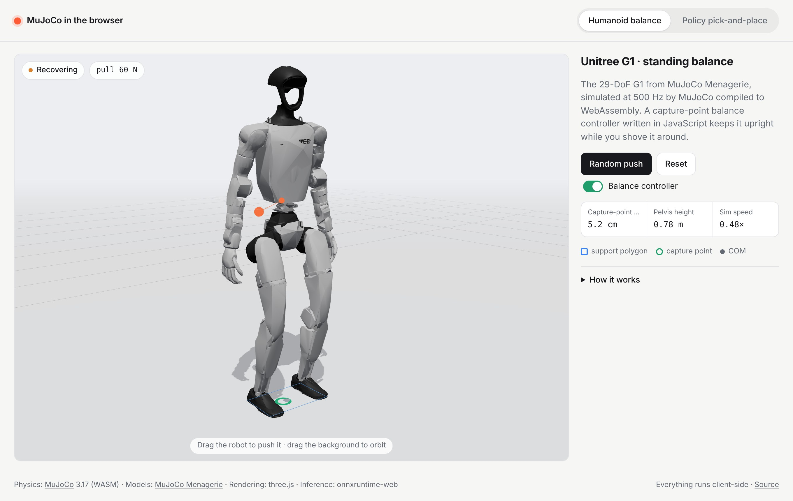
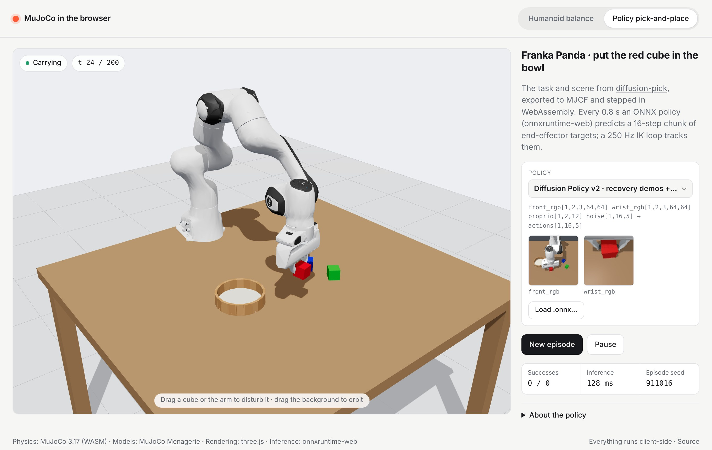
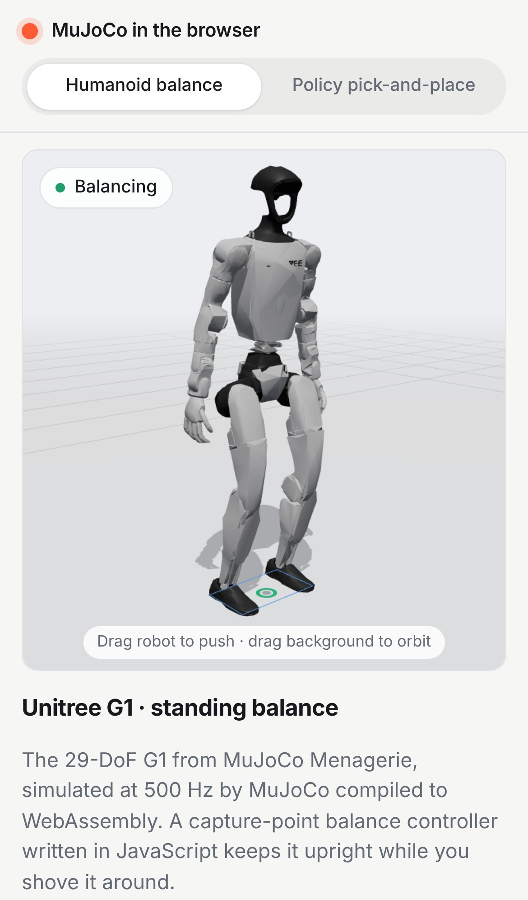
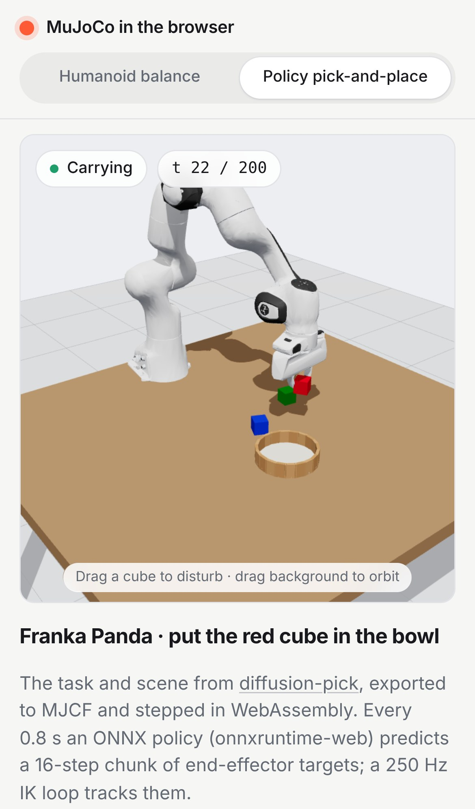

# mujoco-web-demo

MuJoCo physics running entirely in the browser via the official WebAssembly build. It is a static site:
no backend and no build step, and every dependency is vendored.

| Tab | What you can do |
|---|---|
| **Humanoid balance** | Click-drag (or touch-drag) the **Unitree G1** from MuJoCo Menagerie to shove it while a capture-point balance controller written in JavaScript keeps it standing. Toggle the controller off to compare with the bare position servos. |
| **Policy pick-and-place** | A **Franka Panda** puts the red cube in the bowl. The task is the one from [diffusion-pick](https://github.com/ansh1113/diffusion-pick), driven by an **ONNX policy** through onnxruntime-web. The default is diffusion-pick's Diffusion Policy v2 (`dp_v2`), acting from the 64×64 camera images. The v1 policy (as exported, and fine-tuned on this page's renders) and a scripted placeholder are selectable. You can drag the cubes or the arm to disturb it. |





<p align="center">
  
  &nbsp;&nbsp;
  
</p>

*Screenshots are written by the Playwright test (`npm test`) in headless Chromium with SwiftShader software WebGL.
That renderer is also why the "Sim speed" readout shows about 0.45× in them; on a GPU both demos run in real time.*

## Run it

```bash
python3 -m http.server 8000
```

Then open http://localhost:8000. Any static host works: GitHub Pages, Netlify, or `npx serve`. The tab state is
kept in the URL hash (`#balance`, `#pick`).

To deploy on GitHub Pages, go to Settings → Pages and set the source to the default branch, root folder. No
cross-origin-isolation headers are needed because the single-threaded MuJoCo and onnxruntime builds are used.

## Tab 1: Unitree G1 balance

* **Model.** `assets/g1/g1.xml` is Menagerie's 29-DoF G1, unmodified. Its meshes are decimated from 393k to 45k
  triangles (`tools/build_g1_assets.py`), which cuts them from 20 MB to 2 MB. The masses and inertias are explicit
  in the MJCF, and the build script asserts that they are identical to Menagerie's.
* **Perturbation.** Grab any body to drag it with a damped spring (capped at 160 N), applied through
  `xfrc_applied` at the body's centre of mass, with the matching torque for an off-centre grab. *Random push*
  applies 130 N for 0.1 s to the torso.
* **Controller** (`js/g1/balance.js`, about 150 lines). It runs every 2 ms physics step:
  * It computes the whole-body COM *c*, the COM velocity *v* and the capture point *ξ = c + v/ω*, with *ω = √(g/z)*.
  * The capture-point error relative to the foot-support centre, taken in the robot's heading frame, drives an
    **ankle strategy** (ankle pitch/roll offsets that move the centre of pressure).
  * It also drives a **hip strategy**: hip pitch/roll offsets from the CP error plus pelvis tilt and rate.
  * A waist term keeps the torso upright.
  * The offsets are added to a slightly crouched posture, and Menagerie's position servos (kp = 500, critically
    damped) turn them into torques.
* **Tuning.** Gains were found by random search in Python MuJoCo 3.17 (the same engine version as the WASM build)
  on a push benchmark. The JS port reproduces the Python numbers.

`npm run bench` (`tests/balance_bench.mjs`) runs this benchmark headless in Node, with the shipped JS controller
and the shipped WASM build. Each value is the largest 0.1 s push on the torso that the robot survives:

| Direction | Servos holding Menagerie `stand` keyframe | Balance controller |
|---|---:|---:|
| forward | 50 N | **250 N** |
| backward | 38 N | **113 N** |
| left / right | 144 N | **169 N** |
| forward-left | 69 N | **219 N** |
| back-left | 56 N | **169 N** |

**Limits.** This is a standing controller and it does not take steps. A sustained sideways pull of about 50 N
needs more centre-of-pressure shift than the 30 cm stance allows, so the robot tips onto one foot and pivots or
falls. The page auto-resets 1.8 s after a fall. Capture-point stepping is the natural next step. A first
IK-based stepping attempt was not shipped: it lifted the swing foot without first shifting weight onto the stance
foot, so the robot rolled toward the unsupported side and forward push tolerance dropped from 250 N to 56 N. A real
stepping controller needs a weight-shift phase before lift-off.

## Tab 2: Franka pick-and-place with an ONNX policy

* **Scene.** `assets/franka/pick_scene.xml` is produced by diffusion-pick's own `dpick.env.build_model()`
  (`tools/build_franka_scene.py` serializes the `MjSpec`). It has the same Panda with the lite visual meshes, the
  same table, cubes and bowl, and the same `front` and `wrist` cameras, lights and solver options.
* **Environment.** `js/franka/env.js` ports `PickPlaceEnv` line by line:
  * a 10 Hz action `[x, y, z, yaw, grip]` (absolute TCP target);
  * a 250 Hz damped-least-squares IK loop with null-space posture regulation;
  * the same layout randomization, 12-D proprio and success test.
* **Policy loop** (`js/franka/app.js`, `js/franka/policy.js`). It mirrors `scripts/eval_onnx.py`:
  * It keeps an observation history of `To` frames.
  * When the action queue is empty, it runs the model and enqueues actions `To-1 … To-1+7`, a receding horizon of
    8 steps, i.e. 0.8 s.
  * Physics pauses while inference is in flight.
  * Episodes time out after 200 steps (20 s). After a success, a new random layout starts.
* **Observations.** Proprio is read from MuJoCo. `front_rgb` and `wrist_rgb` are 64×64 renders of the MJCF cameras.
  They are read back asynchronously into the uint8 `[1, To, 3, 64, 64]` layout diffusion-pick uses, and shown in
  the side panel as "what the policy sees".

### Policy slot

The tab loads the model named in **[`js/franka/policy-slot.js`](js/franka/policy-slot.js)**. Inputs are fed
**by name**, so any model that uses a subset of `front_rgb`, `wrist_rgb`, `proprio`, `noise` and `object_state`
works without code changes. See [`models/README.md`](models/README.md) for the full contract.

* **Default: `models/dp_v2.onnx` (27 MB).** diffusion-pick's v2 Diffusion Policy, byte-identical to
  `exports/dp_v2.onnx` on its `claude/dp-v2-recovery-aug` branch. Same architecture and I/O as v1, trained with
  recovery demos (one deliberate mistake per episode, then a re-grasp) and strong photometric augmentation. It
  was **not** trained on browser renders, and succeeds on **45/50** browser layouts. Its DDIM-unrolled graph takes
  about 90–105 ms per chunk on single-threaded WASM.
* **`models/dp_browser.onnx` (27 MB)**, selectable. v1 (`dp_reduced`) fine-tuned on browser renders (next
  section), **43/50** in the browser.
* **`models/dp_reduced.onnx` (27 MB)**, selectable. v1 exactly as exported (byte-identical to
  `exports/dp_reduced.onnx`), **40/50** in the browser.
* **Placeholder: `models/placeholder_pick.onnx` (5.8 KB)**, selectable. A scripted, stateless controller compiled
  to ONNX ops by `tools/make_placeholder_policy.py`; it reads **privileged** `object_state` instead of images, so it
  is a stand-in for the wiring, not a learned policy (50/50 in Python, 20/20 in the JS port).
* **Other exports** load through **Load .onnx…**, `?policy=models/<name>.onnx#pick`, or `policy-slot.js`;
  inputs are matched by name.

### Closing the render gap

The browser renders the policy's cameras with three.js, not MuJoCo's OpenGL renderer. Geometry, poses, FOV and the
black background match pixel for pixel, but lighting differs: three.js renders the table darker, the bowl greyer and
the shadows softer (mean front-camera RGB 159/133/108 vs 187/155/123 in the training data). To close that gap,
the training demos were re-rendered through this page and the policy fine-tuned on both renderers.

1. **Recover the state of every training frame.** diffusion-pick's zarr stores images, proprio and actions but
   not `qpos`. The expert is deterministic per seed, so `scripts/export_states.py` (diffusion-pick) re-runs it for all
   200 demos and records `qpos` + bowl position per frame. The re-run reproduces the zarr's proprio and actions with
   **0.0** error.
2. **Re-render in the browser.** `tools/lab/run.cjs render` sets each recorded state in the WASM sim and captures the
   64×64 `front`/`wrist` images with the site's own camera code (`js/franka/cams.js`) in headless Chromium:
   10,035 frames in 12.6 min. `tools/replay_to_zarr.py` writes them, with the original actions/proprio/episode
   boundaries, to `diffusion-pick/data/demos_64_threejs.zarr`.
3. **Fine-tune** (`scripts/finetune.py`, diffusion-pick) from `runs/dp_reduced/best.pt`:
   * each batch of 64 is half original MuJoCo frames, half three.js frames;
   * brightness/contrast/saturation jitter is raised from ±0.2 to ±0.3, plus a ±12% per-channel colour gain;
   * the checkpoint's action/proprio normalizers are kept;
   * lr 1e-4 with a cosine schedule over a 75-minute budget on 4 CPU cores: 10,390 steps, loss 0.0145 → 0.0119.

   The final EMA weights are exported as `dp_browser.onnx` (matches torch to 5e-7). Only the final checkpoint was
   evaluated, so no checkpoint was picked using the test layouts.
4. **Evaluate** both models closed-loop on the same 50 layouts in headless Chromium with
   `node tools/lab/run.cjs eval --policy models/<name>.onnx --seeds 1000:1050`. This uses the site's env, cameras and
   policy runner, a receding horizon of 8 and a 200-step limit, like `eval_onnx.py`. Results are in
   `results/browser_eval_*.json`.

| Policy | Browser (three.js renders, 50 layouts) | diffusion-pick Python eval (MuJoCo renders, 50 seeds) |
|---|---:|---:|
| `dp_reduced` (before) | 40/50 (80%) | 44/50 (88%) |
| `dp_browser` (after) | 43/50 (86%) | 41/50 (82%) |

**How to read this.**
* **Not a significant improvement.** In the browser the fine-tune wins 7 layouts and loses 4 (exact McNemar
  p ≈ 0.55). On MuJoCo renders it wins 5 and loses 8 (p ≈ 0.58). At n = 50 neither change is distinguishable from
  noise.
* **The render gap was smaller than expected.** The original policy already reached 80% in the browser against
  88% on its own renders, because it was trained with colour jitter.
* **Most of the earlier "gap" was a bug.** The page used to render the policy cameras with the previous frame's
  poses. Fixing that, not the fine-tune, is what made `dp_reduced` usable here.
* **Default at the time.** `dp_browser` cleared the pre-agreed bar of beating 40/50 and became the default. It has
  since been replaced by `dp_v2`, which needed no browser fine-tuning (next section).

The Python numbers come from diffusion-pick's `scripts/eval_onnx.py --n 50` with OSMesa rendering, whose frames
match the original dataset exactly. The earlier 87/100 for `dp_reduced` is its 100-episode run of `evaluate.py`.

### Browser results

All three Diffusion Policies on the same 50 layouts (seeds 1000–1049), with the same diffusion noise per seed,
in headless Chromium. Paired comparisons use `python tools/compare_evals.py A.json B.json`, the same exact
two-sided McNemar test as diffusion-pick's `scripts/compare_paired.py`.

| Policy | Browser success | Mean steps on success | diffusion-pick's own eval (MuJoCo renders) |
|---|---:|---:|---|
| `dp_reduced` (v1, as exported) | 40/50 (80%) | 69.8 | 87% nominal, 100 seeds |
| `dp_browser` (v1 + browser fine-tune) | 43/50 (86%) | 52.5 | 41/50 (`eval_onnx.py`, above) |
| **`dp_v2`** (default) | **45/50 (90%)** | 59.0 | 95% nominal, 93% under lighting shifts, 100 seeds |

| Comparison (same seeds) | A fail → B success | A success → B fail | Exact McNemar p |
|---|---:|---:|---:|
| `dp_browser` → `dp_v2` | 5 | 3 | 0.73 |
| `dp_reduced` → `dp_v2` | 9 | 4 | 0.27 |
| `dp_reduced` → `dp_browser` | 7 | 4 | 0.55 |

* **Why `dp_v2` is the default.** The rule, set before the eval, was to switch if it was at least as good as
  `dp_browser` (≥ 43/50). It scored 45/50.
* **The advantage is not significant.** 5 layouts fixed against 3 broken (p = 0.73). No pair of these three policies
  is significantly different at n = 50.
* **v2 needs no browser-specific training.** The browser fine-tune gave v1 a non-significant +3. v2 reaches 45/50
  out of the box, consistent with its lighting robustness in diffusion-pick (93% vs v1's 67% under lighting
  perturbations, p = 8.7e-7) and with recovery demos that let it re-grasp after a bad first attempt.
* **Next step.** Ranking these policies reliably in the browser needs ≥ 200 layouts. A browser fine-tune of v2
  is the obvious follow-up.

The v2 MuJoCo-render figures are from diffusion-pick's `claude/dp-v2-recovery-aug` README, not re-run here. Its
code diff touches only training (training-only distractor pool, stronger augmentation, recovery expert); the
test env, action semantics and proprio are unchanged, so this page's JS env port applies to v2 as-is.

## Tests

```bash
npm test
```

This runs `tests/e2e.cjs` with Playwright and headless Chromium, using SwiftShader WebGL. The test:

* serves the site statically;
* checks that the G1 stands, survives a 130 N push with the controller on and falls without it;
* performs a real mouse drag on the torso and checks that grab and release work;
* switches tabs and checks that the hidden tab's loop stops;
* checks that the default is the image-based Diffusion Policy, waits for it to put the cube in the bowl, and checks
  that the 64×64 policy views render;
* switches the picker to the placeholder and waits for it to complete an episode;
* loads diffusion-pick's `dp_reduced.onnx` through the file input and checks that it runs 20 control steps
  without errors;
* repeats the drag and tab checks on an iPhone 13 viewport, with touch drag and a check for horizontal overflow;
* **fails on any console error or warning, page error, failed request or HTTP 4xx/5xx**;
* rewrites the screenshots in `docs/screenshots/`.

Set `SCREENSHOTS=0` to keep the screenshots, or `DPICK_ONNX=…` to point it at another export. On the last run all
21 checks passed with 0 console messages.

```bash
npm run bench
```

This runs the push-recovery table above, in Node.

## Layout

```
index.html, css/style.css      page shell (tabs, panels; light/dark, mobile layout)
js/main.js                     tab switching, lazy loading, only the visible demo runs
js/runtime.js                  MuJoCo WASM loader (manifest -> virtual FS -> MjModel), small linear algebra, seeded RNG
js/viewer.js                   three.js scene built from MjModel geoms/meshes, synced from geom_xpos/xmat
js/perturb.js                  click/touch-drag spring perturbation via xfrc_applied
js/loop.js                     rAF loop that tracks wall-clock time (slow devices degrade to slow motion)
js/g1/                         balance controller + tab 1
js/franka/                     env port, ONNX policy runner, policy cameras, policy slot, tab 2
assets/g1, assets/franka       MJCF + meshes (+ manifest.json for the virtual FS)
models/                        dp_v2 (default), dp_browser, dp_reduced, placeholder (+ slot docs)
results/                       browser evaluations (per-episode JSON); tools/compare_evals.py pairs them
tools/                         asset/policy build scripts (Python)
tools/lab/                     headless re-render + closed-loop eval with the site's own modules (Playwright)
tests/                         Playwright e2e, Node push benchmark
vendor/                        @mujoco/mujoco 3.17.0, three 0.180.0, onnxruntime-web 1.23.2 (see vendor/README.md)
```

Rebuild the assets (optional, since the outputs are committed):

```bash
pip install mujoco onnx onnxruntime fast-simplification
git clone --depth 1 https://github.com/google-deepmind/mujoco_menagerie /tmp/menagerie
python tools/build_g1_assets.py --menagerie /tmp/menagerie
python tools/build_franka_scene.py --dpick ../diffusion-pick
python tools/make_placeholder_policy.py
python tools/make_manifests.py
```

## Credits

* [MuJoCo](https://github.com/google-deepmind/mujoco) and its WASM bindings (Apache-2.0)
* Unitree G1 and Franka Emika Panda models from [MuJoCo Menagerie](https://github.com/google-deepmind/mujoco_menagerie).
  Their licenses are copied next to the assets: `assets/g1/LICENSE.menagerie`, `assets/franka/LICENSE.menagerie-panda`.
* [three.js](https://threejs.org) (MIT) and [onnxruntime-web](https://onnxruntime.ai) (MIT)
* Task, scene and policy export from [diffusion-pick](https://github.com/ansh1113/diffusion-pick)
